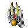
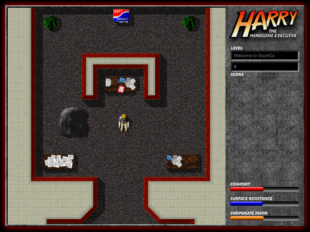

#  Harry the Handsome Executive
Mac game by Ben Spees and Ambrosia Software, 1997.
Website: https://metalsnake-classic-mac-ports.github.io/Ouro-Harry-the-Handsome-Executive/

# About this project
Ouro Harry: a new implementation of Harry the Handsome Executive in Rust, for
macOS, Windows and Linux. The rules come from the original's PowerPC code
(version 1.0.1) and are checked against it: its routines run in Unicorn next
to the port, and both have to compute the same, case by case. The game data
comes from the original files: `ouro-harry-extract` converts them into a data
pack, `harry-data.zip` (PNG, WAV and text), which the game reads. The
gameplay should stay as close to the original as possible, with optional
modern extensions.

Part of *MetalSnake's Classic Mac Ports*; "Ouro" (from Ouroboros) is the
name of these ports: the old game in a new skin.

Work in progress, see [TODO.md](TODO.md): all 15 levels of Episode 1 play.

## Building
You need Rust (via [rustup](https://rustup.rs)) and SDL3
(macOS: `brew install sdl3`).

The game data is not included. You need the original game, Harry the
Handsome Executive 1.0.1, installed on a classic Mac or in an emulator
(SheepShaver), and the resource fork of Apple's QuickTime Musical
Instruments for the music. Copy the installed files as MacBinary into a
folder (`Harry 1.0.1.bin`, `Harry Graphics.bin`, `Harry Titles.bin`,
`Harry Sounds.bin`, `Harry Music.bin`, `Harry Instruments.bin`,
`Episode 1.bin`) and make the data pack:

    cargo run --release -p harry-original --bin ouro-harry-extract -- \
        FOLDER harry-data.zip "QuickTime Musical Instruments.rsrc"

Then:

    cargo test
    cargo run --release -p harry -- harry-data.zip

`ouro-harry [pack.zip] [level]` plays the game: main menu (New Game,
Continue Game, Instructions, Options, Credits, Quit), the story, the levels,
music and sound; a level number starts it at once. Without a path the pack
is looked for next to the program, in the current folder and in
`re/work/`. Default keys as on the Mac: ← → turn, ↓ scoot, ↑ inch, Space
kick, Control select item, Option (Alt) use item, 1–4 pick a weapon or the
swivel, Tab the map, Caps Lock pause; Command (or Ctrl) + I opens the
options during a game, F11 switches to full screen, Esc asks before giving
up the game. The game pauses when its window loses the focus. Keys,
scaling (whole pixels or free), full screen, volumes and saving between
levels are set in the options, which are saved in SDL's preference folder
(macOS: `~/Library/Application Support/MetalSnake/Ouro Harry`), with the
saved game. F8 / F7 jump to the next / previous level (for testing).
`ouro-harry --screenshot out.bmp [level] [frames]` runs the frames
without a window and writes the picture; with `HARRY_SAVE=<file>` it, and
Continue Game, start from that saved game.

The tests against the original (crate `harry-original`) need the
recordings and files in the gitignored `re/work/` and are skipped without
them.

## Folders
- `crates/harry-core/`: game logic, one call per frame of the original, no
  I/O; the doc comments name the original's routines
- `crates/harry-data/`: the game data and the data pack the game reads
- `crates/harry-original/`: reads the original (MacBinary, resource fork,
  PICT, `cicn`, `HrSp` faces, `snd`, the levels, QuickTime music), writes
  the data pack; the tools `ouro-harry-extract` and `ouro-harry-repro`
  (saved games that put Harry where a bug of the original shows) and the
  tests against the original
- `crates/harry/`: the SDL3 frontend, `ouro-harry`
- `re/tools/`: the recorders that run the original's routines in Unicorn
  (`emu_*.py`), tools to run the original in systemless (`sl_repro.py`,
  `sl_peek.py`), the licence file for testing the original registered
  (`harry_license.py`) and the website's pictures (`site_assets.py`)
- `docs/`: the website (GitHub Pages)
- `NOTES.md`: how the original works, from the analysis of its code, and
  the port's deliberate differences ("Port improvements")
- `BUGS.md`: bugs and oddities of the original, how to see them, and what
  the port does with them
- `TODO.md`: what is still to do

## Credits
Harry the Handsome Executive © 1997 Ben Spees / Ambrosia Software, Inc.
Programming and design: Ben Spees; music: Eric Speier; plot and design:
Blake Wilson, Josh Rothman; game and title artwork: John Sledd; additional
artwork: Ben Spees; sound effects: Ben Spees (voice of Harry), Andrew
Welch / Ambrosia Labs, Juliet Wong. This project is not affiliated with
them.

## License
The code is free software under the GNU General Public License, version 3
or later (see [LICENSE](LICENSE)). The game's pictures, sounds, music and
levels are not covered by it: they belong to the authors of the original
game, as do the pictures of the website made from them.
